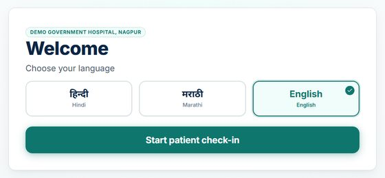
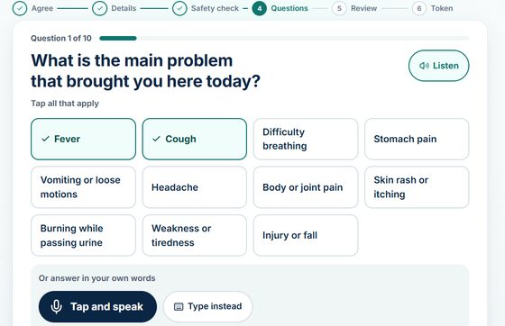
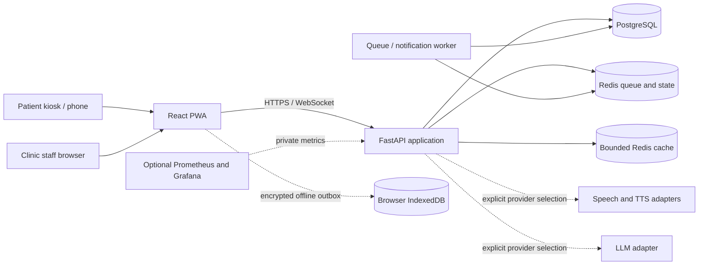

# OPD Saathi

OPD Saathi is a voice-first, multilingual patient history-taking and queue kiosk for crowded
government hospital outpatient departments (OPDs) in Maharashtra. A patient picks Marathi, Hindi
or English, answers 8–12 questions by speaking, tapping or typing, and gets a queue token. Before
the patient walks in, the doctor has a one-page English case sheet with the patient's own words.

**OPD Saathi does not diagnose.** It collects the patient's account for the clinical team. It
does not name a disease, suggest a medicine or a dose, or lower a patient's urgency; staff make
every clinical decision. See [Safety and limitations](#safety-and-limitations).

<p>
  
  
</p>

Submitted to Hack for Social Cause (VBYLD 2027), theme Healthcare & Wellbeing. Open source under
the [MIT license](LICENSE). Most of the code was written with AI assistance:
see [AI_DISCLOSURE.md](AI_DISCLOSURE.md).

| Who | Where | What they do |
|---|---|---|
| Patient | `/kiosk` | Picks a language; agrees; gives age and sex; flags danger signs; answers 8–12 questions, each read aloud; checks a read-back in their own language; gets a token, a department, a place in the queue and a QR code |
| Patient's phone | QR code → `/s/<token>` | Live place in the queue and estimated wait |
| Nurse | `/staff` → Queue | Live queue with urgent and "patient asked for help" alerts; call, no-show, urgency and department changes; registering a patient who needs help |
| Doctor | `/staff` → Queue → case sheet | One-page English case sheet with the patient's own words, a short AI brief marked as a draft, danger signs and the transcript; start and finish the consultation; PDF |
| Admin | `/staff` → Reports, Settings | Daily volumes, waits, languages and departments; staff, kiosks, departments and the AI switch |

## Quick start (Windows)

You need [Docker Desktop](https://www.docker.com/products/docker-desktop/) running, and Chrome or
Edge for voice. From the repository root:

```powershell
powershell -ExecutionPolicy Bypass -File .\start-demo.ps1
```

The first run builds the images and takes several minutes; later runs take seconds. The script:

1. creates `.env` from `.env.example` with random local secrets, if `.env` does not exist yet;
2. starts PostgreSQL and Redis and applies the database migrations;
3. creates a fictional demo hospital in Nagpur with staff accounts, a month of past OPD days for
   Reports, and a returning patient;
4. starts the API, the background worker and the web app;
5. prints the staff logins and a one-time kiosk activation link, and opens the kiosk.

Then open the staff workspace at <http://localhost:5173/staff> (the script uses port 8080
instead if 5173 is busy) and the API documentation at <http://localhost:8000/docs>. Phones on
the same Wi-Fi can scan the token QR code. Stop everything with `docker compose down`.

**AI and natural voices are optional.** Put `GEMINI_API_KEY` (and, for the best Hindi and
Marathi voices, `SARVAM_API_KEY`) in `.env` and run the script again. Without keys everything
still works: tap-to-answer, the browser's own speech recognition and read-aloud, rules-based
danger-sign alerts, routing, tokens and the live queue.

To present the demo, follow [docs/DEMO.md](docs/DEMO.md) (about ten minutes, with a pre-demo
check and what to do when something fails).

## Manual setup (Linux, macOS, or Windows with WSL2)

For development. You need Docker with Compose, Python 3.12, Node.js 24 (the exact version is in
`apps/web/.nvmrc`) and GNU Make. Run these from the repository root.

1. **Settings.** Copy the template, then replace every `replace-with-…` value with your own
   random value: `openssl rand -hex 32` for passwords and `JWT_SECRET`, and
   `openssl rand -base64 32` for `APP_DATA_KEY`, `APP_HMAC_KEY` and `CURSOR_HMAC_KEY`. The
   password inside each `DATABASE_URL`, `MIGRATIONS_DATABASE_URL`, `WORKER_DATABASE_URL`,
   `REDIS_STATE_URL` and `REDIS_CACHE_URL` must match `OSA_APP_PASSWORD`,
   `OSA_MIGRATOR_PASSWORD`, `OSA_WORKER_PASSWORD` and `REDIS_PASSWORD`. To sign in without
   two-step codes, as the demo does, set `MFA_REQUIRED_ROLES=none`. Never commit `.env`.

   ```sh
   cp .env.example .env
   ```

2. **Dependencies.**

   ```sh
   python3.12 -m venv .venv && . .venv/bin/activate
   pip install --require-hashes -r services/api/requirements.lock.txt
   npm ci --prefix apps/web
   ```

3. **Database and cache** in Docker, then the schema:

   ```sh
   docker compose up -d postgres redis redis-cache worker-role-bootstrap
   make migrate
   ```

4. **Load the settings into the shell.** The API, the worker and the command-line tools run
   from `services/api` and read the environment, not the root `.env`. Repeat this in every new
   terminal.

   ```sh
   set -a; . ./.env; set +a
   ```

5. **Demo hospital, staff and a kiosk:**

   ```sh
   make demo-seed
   (cd services/api && python -m app.cli demo-kiosk --web-url http://localhost:5173)
   ```

   The second command prints a kiosk activation link; open it once in Chrome or Edge.

6. **Run** each in its own terminal:

   ```sh
   make api      # API on http://localhost:8000 (docs at /docs, readiness at /readyz)
   make worker   # background worker
   make web      # web app on http://localhost:5173 (kiosk at /kiosk, staff at /staff)
   ```

Installing at a real hospital is different: see [docs/DEPLOYMENT.md](docs/DEPLOYMENT.md). Never
use the demo script or demo data for real patients.

## Environment variables

All settings live in `.env`, which is created from [`.env.example`](.env.example). The template
lists all 83 settings with comments; CI checks that each one is read by the code
(`scripts/check_env_example.py`). The values below are the template's defaults. A
`replace-with-…` placeholder must be replaced with your own secret; `start-demo.ps1` does that
for you.

### Needed to run

| Variable | What it is | Default |
|---|---|---|
| `APP_ENV` | `development`, `test` or `production` | `development` |
| `WEB_ORIGIN` | Web app address(es) the API accepts requests from, comma-separated | `http://localhost:5173` |
| `PUBLIC_WEB_URL` | Address patients' phones use to open the token QR link, e.g. `http://192.168.1.20:5173`. `start-demo.ps1` fills in this PC's Wi-Fi address | empty |
| `POSTGRES_DB`, `POSTGRES_USER`, `POSTGRES_PASSWORD` | Database name and administrator, used by Docker to create the database | `osa`, `postgres`, placeholder |
| `OSA_APP_PASSWORD`, `OSA_MIGRATOR_PASSWORD`, `OSA_WORKER_PASSWORD` | Passwords of the three database roles: the API, migrations and the worker | placeholders |
| `DATABASE_URL`, `MIGRATIONS_DATABASE_URL`, `WORKER_DATABASE_URL` | Connection strings for those roles | `postgresql+asyncpg://osa_app:…@127.0.0.1:5432/osa` and similar |
| `REDIS_PASSWORD`, `REDIS_STATE_URL`, `REDIS_CACHE_URL` | Redis password; the queue state (port 6379) and the bounded cache (port 6380) | placeholder, `redis://…` |
| `JWT_SECRET` | Signs staff and kiosk sign-in tokens; at least 32 random bytes | placeholder |
| `APP_DATA_KEY` | Encrypts patient data in the database (base64, 32 bytes). Back it up: losing it makes the data unreadable | placeholder |
| `APP_HMAC_KEY`, `CURSOR_HMAC_KEY` | Keys for lookup hashes and signed page cursors (base64, 32 bytes) | placeholders |
| `MFA_REQUIRED_ROLES` | Roles that must use two-step sign-in; `none` for the local demo | `admin` |
| `DEMO_ADMIN_EMAIL`, `DEMO_ADMIN_PASSWORD`, `DEMO_STAFF_PASSWORD` | Logins created for the fictional demo hospital (passwords of 12 or more characters) | `admin@demo.opdsathi.test`, placeholders |

### AI and voice (optional)

| Variable | What it is | Default |
|---|---|---|
| `GEMINI_API_KEY` | Google Gemini: English case sheet and doctor's brief from Hindi or Marathi answers, extra follow-up questions, reading photos of old papers, and speech when there is no Sarvam key. Free key: <https://aistudio.google.com/apikey> | empty |
| `SARVAM_API_KEY` | Sarvam AI: the best Hindi and Marathi speech recognition and natural Indian voices. Free credits: <https://dashboard.sarvam.ai> | empty |
| `LLM_PROVIDER`, `STT_PROVIDER`, `TTS_PROVIDER` | Which service writes text, recognises speech and reads aloud; `auto` uses whichever keys are set; without keys, speech and read-aloud use the browser | `auto` |
| `LLM_MODEL`, `LLM_FALLBACK_MODEL` | Gemini models used for case sheets and briefs | `gemini-3.5-flash-lite`, `gemini-3.1-flash-lite` |
| `LLM_ENABLED` | Switches all AI off when `false`; a hospital can also switch AI off in Settings | `true` |
| `LLM_MAX_CALLS_PER_SESSION` | Most AI calls allowed for one patient's check-in | `30` |
| `AI_FOLLOWUP_QUESTIONS` | Lets Gemini add up to three complaint-specific follow-up questions | `true` |
| `PROVIDER_MODE` | `demo-safe` replays recorded answers with no network calls, for offline rehearsals | `standard` |

### Queue, data, messages and monitoring

| Variable | What it is | Default |
|---|---|---|
| `URGENT_BONUS_MIN`, `PRIORITY_BONUS_MIN`, `VULNERABLE_BONUS_MIN` | Head start in the queue, in minutes ([docs/QUEUE_POLICY.md](docs/QUEUE_POLICY.md)) | `360`, `45`, `15` |
| `DEFAULT_CONSULT_MIN` | Consultation length used for wait estimates until real ones are measured | `4.0` |
| `RETENTION_DAYS`, `ANONYMISE_DAYS` | Defaults for the retention job (`make retention`): delete interview detail after this many days, and pseudonymise patients after this many | `30`, `90` |
| `NOTIFICATION_PROVIDER` | Queue messages to patients: `console` (printed only), `twilio` or `whatsapp`; the last two need the `TWILIO_*` or `WHATSAPP_*` settings and `NOTIFY_KEY` | `console` |
| `METRICS_ENABLED`, `GRAFANA_ADMIN_PASSWORD` | Optional Prometheus metrics and Grafana dashboards, for a private network only | `false`, placeholder |
| `LOG_LEVEL` | How much the services log; logs never contain patients' answers or names | `INFO` |

## Architecture



| Part | Folder | Built with |
|---|---|---|
| Web app: kiosk, staff workspace, phone pages | [`apps/web`](apps/web/) | React 19, TypeScript, Vite, Tailwind CSS; installable and works offline (PWA) |
| API | [`services/api`](services/api/) | Python 3.12, FastAPI, SQLAlchemy, Alembic migrations |
| Background worker | [`services/api/app/workers`](services/api/app/workers/) | Queue events, queue repair, messages to patients, alert checks |
| Database | [`services/api/migrations`](services/api/migrations/) | PostgreSQL 16, with row-level security keeping each hospital's data separate |
| Queue state and cache | | Redis 7 |
| Monitoring (optional) | [`infra/monitoring`](infra/monitoring/) | Prometheus, Grafana, Alertmanager |

Technical design documents:

- [docs/ARCHITECTURE.md](docs/ARCHITECTURE.md): the architecture diagram and trust boundaries
- [docs/OPD_Saathi_Documentation.pdf](docs/OPD_Saathi_Documentation.pdf): the technical documentation
- [docs/OPD-Saathi-Complete-Guide.pdf](docs/OPD-Saathi-Complete-Guide.pdf): the complete guide to every screen and feature
- [docs/DECISIONS.md](docs/DECISIONS.md): architecture decision records
- [docs/SCALING.md](docs/SCALING.md): sizing and load
- [docs/QUEUE_POLICY.md](docs/QUEUE_POLICY.md): how the queue decides who is called next
- [docs/PRIVACY.md](docs/PRIVACY.md) and [docs/THREAT_MODEL.md](docs/THREAT_MODEL.md): data protection and security
- [docs/DEPLOYMENT.md](docs/DEPLOYMENT.md): installing at a hospital

## Tests

With the manual setup done (the backend tests need the database and Redis from steps 3 and 4):

```sh
make lint   # ruff, mypy --strict, ESLint, TypeScript
make test   # pytest services/api/tests, then the web unit tests (npm --prefix apps/web test)
make e2e    # Playwright end-to-end tests (npm --prefix apps/web run e2e)
make eval   # synthetic evaluations, no network (python eval/run_all.py)
```

| Suite | Where | Size |
|---|---|---|
| Backend unit and integration tests (pytest) | [`services/api/tests`](services/api/tests/) | 151 files, including 100 test modules |
| Web unit tests (Vitest) | `apps/web/src` (`*.test.ts`, `*.test.tsx`) | 28 files |
| End-to-end tests (Playwright, Chromium) | [`apps/web/e2e`](apps/web/e2e/) | 27 specs |
| Evaluations: interview, danger signs, routing, extraction, adversarial prompts | [`eval/`](eval/) | 7 gates; results in [docs/EVALUATION.md](docs/EVALUATION.md) |

Before the first `make e2e`, install the browser once with
`cd apps/web && npx playwright install chromium`. The end-to-end tests start their own web
server and mock the API, so they need no backend. The automated tests never call a live AI or
speech service.

CI ([`.github/workflows/ci.yml`](.github/workflows/ci.yml)) runs all of these on every pull
request, plus a 95% coverage gate on the core and domain code, security and image scans, and a
production smoke test that runs the whole stack over HTTPS.

## Sample data

All sample data is synthetic. Never put real patient information into the demo.

| What | How | What you get |
|---|---|---|
| Demo hospital | `make demo-seed` (also run by `start-demo.ps1`) | A fictional hospital in Nagpur with departments, an admin, eight doctors and five nurses |
| A month of OPD history | `make demo-history`; remove with `make clear-demo-history` | 30 days of finished OPD days (arrivals, waits, consultations, case sheets), so Reports look like a real hospital |
| Walkthrough visits | `make demo-data`; remove with `make clear-demo-data` | Five removable synthetic visits |
| Old papers to photograph | [`docs/demo-papers/`](docs/demo-papers/) | A synthetic prescription and a synthetic lab report |
| Evaluation datasets | [`eval/`](eval/) | JSONL cases for routing, danger signs, extraction, adversarial prompts, speech and interviews |
| Case sheet format | [`docs/case_sheet.schema.json`](docs/case_sheet.schema.json) | The JSON Schema of the doctor's case sheet |

`make seed-bulk` creates 100,000 bare visits for performance tests only. It makes Reports
meaningless, so remove them with `make clear-bulk` afterwards.

## Safety and limitations

- **History-taking and the queue only.** It does not diagnose, suggest a medicine or a dose, or
  check for drug interactions.
- **Danger signs come from fixed rules, not AI.** The rules can only raise a patient's urgency;
  lowering it is a staff decision that is recorded. The rules miss things, so staff stay
  responsible for who is seen first.
- **AI output is always a labelled draft.** The doctor accepts, edits or rejects it, and AI never
  writes the doctor's notes. Values read from photos of old papers stay drafts until a doctor
  checks them against the photo.
- **Clinical content is not yet signed off.** The questions, danger-sign rules, Ayurveda module
  and translations are drafts awaiting clinician and native-speaker review
  ([docs/CLINICIAN_REVIEW.md](docs/CLINICIAN_REVIEW.md)).
- **No live hospital integration.** There is no connection to a hospital system, ABHA or ABDM.

The full list, with the reason for each limit: [docs/LIMITATIONS.md](docs/LIMITATIONS.md). See
also [docs/SAFETY.md](docs/SAFETY.md), [docs/CLINICAL_SAFETY.md](docs/CLINICAL_SAFETY.md) (the
hazard log) and [SECURITY.md](SECURITY.md) (reporting a vulnerability).

## More documentation

| Document | What it covers |
|---|---|
| [docs/DEMO.md](docs/DEMO.md) | The ten-minute demo script |
| [docs/PROBLEM_STATEMENT.md](docs/PROBLEM_STATEMENT.md) | The original problem statement (SIH26047) the project started from |
| [docs/OPD-Saathi-Feature-Guide.pdf](docs/OPD-Saathi-Feature-Guide.pdf) | A shorter feature guide with screenshots |
| [docs/EVALUATION.md](docs/EVALUATION.md) | Results of the synthetic evaluations |
| [CHANGELOG.md](CHANGELOG.md) | What changed in each release |
| [CONTRIBUTING.md](CONTRIBUTING.md) | How changes are made and reviewed |

## License

OPD Saathi is released under the [MIT license](LICENSE). Copyright (c) 2026 Shashi Shekhar Mishra.

## AI disclosure

About 80–90% of the code was written with AI assistance (OpenAI Codex and Anthropic Claude). The
team did the problem research, the design, the testing, the review and the demo. The running app
can also use Google Gemini and Sarvam AI as optional services. Details:
[AI_DISCLOSURE.md](AI_DISCLOSURE.md).
