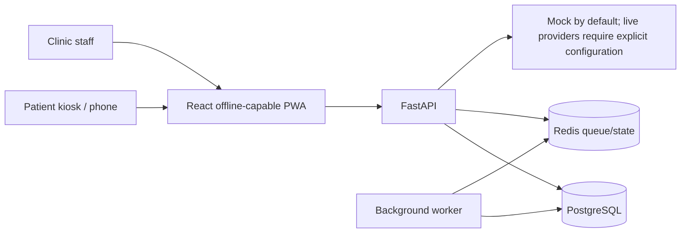

# OPD Saathi

OPD Saathi is a multilingual, voice-first patient history-taking and queue system for crowded outpatient departments (SIH26047, "Patient Case-Taking Software"). It collects a patient's history for clinical staff; it does not diagnose or recommend treatment.

## Run the demo (Windows, macOS or Linux with Docker)

**New teammate?** Follow [CONTRIBUTING.md](CONTRIBUTING.md). It covers getting access, cloning, running the app and pushing your changes step by step.

```powershell
powershell -ExecutionPolicy Bypass -File .\start-demo.ps1
```

The script creates `.env` (random local secrets) if needed, starts PostgreSQL, Redis, the API, the worker and the web app, prepares a fictional demo hospital, and prints a one-click kiosk activation link plus staff logins. Open the kiosk in **Chrome or Edge** for voice. Stop with `docker compose down`.

**Turn on AI and natural voices:** put your keys in `.env` and run the script again.

| Key | What it enables | Where to get it |
|---|---|---|
| `GEMINI_API_KEY` | English case sheet and 2–3 line doctor's brief from Hindi/Marathi answers, AI question ordering, reading old prescription photos, and (without Sarvam) speech-to-text and read-aloud | Free: <https://aistudio.google.com/apikey> |
| `SARVAM_API_KEY` (optional) | Best Hindi/Marathi speech recognition and natural Indian voices | Free credits: <https://dashboard.sarvam.ai> |

Without keys everything still works: tap-to-answer questions, the browser's own speech recognition and voice, rules-based safety alerts, routing, tokens and live queue.

### What each person sees

| Who | Where | What they do |
|---|---|---|
| Patient | `/kiosk` | Picks Hindi, Marathi or English; agrees; gives age and sex; flags danger signs; answers 8–12 questions by tapping, speaking or typing (each question is read aloud); reviews a read-back in their own language; gets a token, department, place in queue and a QR code |
| Patient's phone | QR → `/s/<token>` | Live place in queue and estimated wait |
| Nurse | `/staff` → Queue | Live queue with urgent alerts and "patient asked for help" alerts, call / no-show, urgency and department override, assisted registration |
| Doctor | `/staff` → Queue → Open case sheet | One-page English case sheet with the patient's own words, AI brief, red flags, transcript; edit, start/finish consult, PDF |
| Admin | `/staff` → Reports, Settings | Daily volumes, waits, languages, departments; staff, kiosks, departments, AI switch |

## Project status

Phases 0–14 have implementation reports. Phase 11 adds opt-in notification adapters and audited tenant-scoped analytics. Phase 12 adds encrypted offline short-form intake and replay-safe sync. Phase 13 adds operational hardening and verified backup/restore and failure drills using a separate, temporary synthetic-data stack. Phase 14 adds demo-safe provider selection, Judge Mode UI, and full automated acceptance evidence. See the [phase reports](docs/phase-reports/), [final product readiness review](docs/FINAL_PRODUCT_READINESS.md), [product audit](docs/PRODUCT_AUDIT.md), [evaluation results](docs/EVALUATION.md), and [three-minute demo](docs/DEMO.md).

## Development setup

The supported local setup is Linux, macOS, or Windows with WSL2 and Docker. On Windows, use a WSL2 Linux distribution with Docker Desktop's WSL integration. Required runtimes are Python 3.12 and Node.js 24 LTS.

## How it works



The API enforces tenant scope and deterministic safety rules. See [architecture](docs/ARCHITECTURE.md), [privacy](docs/PRIVACY.md), and [scaling](docs/SCALING.md). Screenshots from earlier phase gates are in [`docs/screenshots`](docs/screenshots/).

Environment check on 5 October 2026: Windows host; Ubuntu is installed as a WSL 2 distribution. From Ubuntu, Docker Desktop 4.93.0 (Engine 29.8.1, Compose 5.5.1), Python 3.12.15, Node.js 24.21.0, npm 11.19.0, and GNU Make are verified. Phase 0 CI is green on commit `462808d`; Compose, migrations, API readiness, tests, and the documented clean-checkout setup were also verified. A local development `.env` with random credentials has been created and verified ignored by Git.

1. Copy `.env.example` to `.env` and replace every local placeholder with private development values. Never commit `.env`.
2. Create and activate a Python 3.12 virtual environment, then install the backend lock: `python -m venv .venv`; activate it; `pip install --require-hashes -r services/api/requirements.lock.txt`.
3. Install the web lock with `npm ci --prefix apps/web`.
4. Start Postgres and Redis with `make up`.
5. Apply the schema with `make migrate`.
6. Run the API with `make api` and the web app with `make web` in separate terminals.
7. Visit `http://localhost:8000/docs`, `http://localhost:8000/readyz`, and `http://localhost:5173`.

The Phase 0 setup steps were run against a clean checkout of `phase-00-foundations`; see the [Phase 0 report](docs/phase-reports/phase-00.md) for the measured scope and results.

### Phase 2 staff and kiosk bootstrap

After applying migrations, run `python -m app.cli create-admin`. The operator prompt creates a synthetic hospital and its first administrator; it prints the hospital ID needed by the `/staff` sign-in form. To add a kiosk, run `python -m app.cli create-kiosk --hospital-id <hospital-id> --label "Demo kiosk"` and use the printed one-time code once with `POST /kiosks/activate`. The app stores only digests of refresh and activation secrets. The signed-in administrator can inspect the append-only audit feed at `GET /audit`; `make demo-ratelimit` sends 11 synthetic failed login requests to demonstrate the 429 response.

### Synthetic demo data

Set `PROVIDER_MODE=demo-safe` for local scripted speech and mock language/TTS adapters, then use `make demo-seed` to provision the fictional Nagpur hospital. Follow [docs/DEMO.md](docs/DEMO.md) to run the three-minute demo and offline check. `make seed-bulk` creates 100,000 synthetic visits for performance work; do not use it against real data. Never use real patient information in this demo.

## Safety and data

Use synthetic data only. This software is for history-taking, not diagnosis. Clinical questions and safety rules remain drafts until reviewed by a clinician. No live hospital, ABHA, or ABDM integration is included in this MVP.
