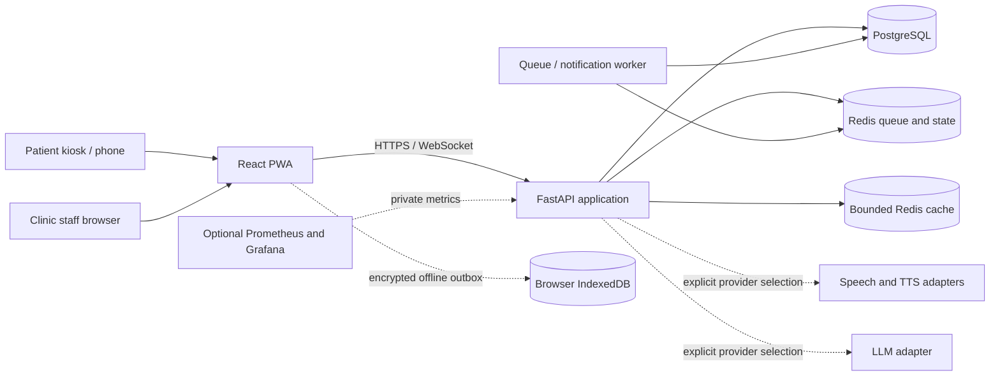

# Architecture

OPD Saathi is a local-first, multilingual intake and queue system. It collects history for clinical staff and does not diagnose or prescribe. The diagram shows the MVP runtime boundaries; no live hospital, ABDM, ABHA, or FHIR integration is configured.

## Trust boundaries

- The browser stores an encrypted offline intake outbox and provisional receipt; server confirmation is required before a real queue token exists.
- The API enforces authentication, tenant scope, request limits, safety rules, and output validation. Rules remain authoritative for urgent flags.
- PostgreSQL stores application records. Durable Redis state supports queue coordination; a separate bounded Redis instance is used for evictable cache data.
- Mock providers are local. Live providers require explicit configuration and credentials. `PROVIDER_MODE=demo-safe` forces mock speech, language, and TTS adapters.
- Optional observability is intended for a private local Compose network. Do not expose it publicly.

See [PRIVACY.md](PRIVACY.md), [SCALING.md](SCALING.md), [EVALUATION.md](EVALUATION.md), and [CLINICIAN_REVIEW.md](CLINICIAN_REVIEW.md) for limits and pending reviews.
